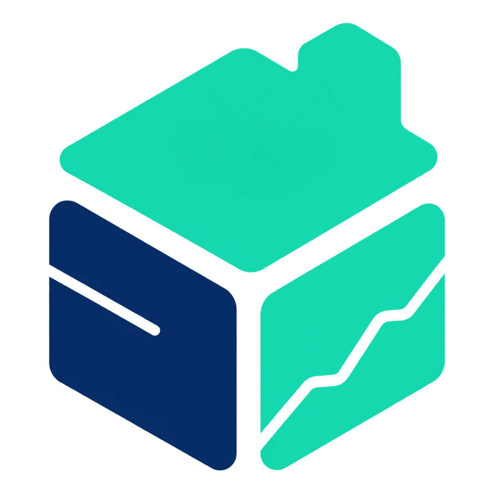

# Topbase

[English](README.md) · 简体中文 · [官网](https://frontitle.github.io/Topbase/zh/) · [在线文档](https://frontitle.github.io/Topbase/zh/docs/)

[](https://github.com/frontitle/Topbase/actions/workflows/ci.yml)
[](LICENSE)
[](CHANGELOG.md)

> **看见数据，理解业务，沉淀增长。**



Topbase 是一站式数据分析与可视化数仓平台，让团队通过连接数据、可视化分析、仪表盘观测和周期物化，把业务问题转化为持续可用的数据资产。

## 核心功能

- **连接数据**：支持 PostgreSQL、MySQL / MariaDB、ClickHouse、SQL Server、Oracle 和 SQLite，提供连接测试、SSL 与 SSH 跳板机接入。
- **可视化分析**：无需编写 SQL，即可通过字段选择、筛选、汇总、排序、跨表关联和自定义列完成分析；熟悉 SQL 的用户也可以切换到代码模式。
- **指标可视化**：将分析结果快速转换为数字、折线图、面积图、柱状图、条形图、饼图、散点图和明细表格。
- **仪表盘观测**：自由组合分析与内容组件，配置筛选联动、主题、布局、分享、嵌入、订阅和告警，持续追踪核心指标。
- **数据沉淀**：把需要周期统计的分析配置为计划任务，将结果物化到数仓表，并通过目录和血缘持续管理数据资产。
- **分析协作**：使用数据组组织个人与团队内容，通过服务端权限控制分析、仪表盘、数据浏览和原生 SQL 能力。
- **AI 与自动化**：通过 MCP 或 CLI 让 AI 在既有权限内理解表和字段、实时问答数据，并在用户确认后创建可继续编辑的分析。

## 安装

选择一种方式即可。首次启动后访问 `http://服务器 IP:端口`，按页面引导创建管理员。

### 方式一：服务器直接运行

适合已安装 Go 的单机服务器。Topbase 直接运行时默认监听 `:80`；为避免首次运行需要低位端口权限，下面显式改为 `8080`，应用数据保存到当前目录的 `data/`：

```bash
git clone --depth 1 --branch v0.2.7 https://github.com/frontitle/Topbase.git
cd Topbase
go build -o topbase ./cmd/topbase
TOPBASE_PORT=8080 TOPBASE_DATA_DIR=./data ./topbase
```

看到 `listening on http://localhost:8080` 后，在浏览器打开 `http://服务器 IP:8080`。如需绑定指定网卡，使用 `TOPBASE_ADDR=127.0.0.1:8080`；不设置 `TOPBASE_PORT` 或 `TOPBASE_ADDR` 时，程序默认监听 `:80`。终端保持运行；需要长期托管、HTTPS 或 PostgreSQL/MySQL 应用数据库时，继续阅读[部署与备份](docs/deployment.md)。

### 方式二：Docker 安装

适合大多数服务器。先安装 [Docker](https://docs.docker.com/get-docker/) 与 Docker Compose，然后执行：

```bash
git clone --depth 1 --branch v0.2.7 https://github.com/frontitle/Topbase.git
cd Topbase
cp -n .env.example .env
chmod 600 .env
openssl rand -base64 32
```

用文本编辑器打开 `.env`。设置独立的强密码 `TOPBASE_APP_DB_PASSWORD`，将上一步的完整输出填入 `TOPBASE_MASTER_KEY`，保存后启动：

```bash
docker compose -f docker-compose.release.yml up -d
curl --fail http://127.0.0.1:8101/api/ready
```

打开 `http://服务器IP:8101`。默认映射为 **服务器 8101 → 容器 8080**。如要使用服务器端口 9000，在 `.env` 中设置 `TOPBASE_HTTP_PORT=9000`，重新执行启动命令，再打开 `http://服务器IP:9000`。

Docker 方案将应用数据库存放在 PostgreSQL 命名卷中。切换版本时，在现有 `.env` 中修改 `TOPBASE_VERSION`，保留密码和主密钥。用 `docker compose -f docker-compose.release.yml config --images` 核对镜像后，再拉取并启动。备份、HTTPS 和版本切换的完整步骤见[安装与运行 Topbase](https://frontitle.github.io/Topbase/zh/docs/installation.html)。

生产部署、配置和升级说明：

- [部署与备份](docs/deployment.md)
- [配置说明](docs/configuration.md)
- [版本升级](docs/upgrading.md)
- [数据库支持](docs/database-drivers.md)
- [AI、MCP 与 CLI](docs/ai-integrations.md)
- [0.2.7 发布说明](docs/releases/0.2.7.md)
- [更新日志](CHANGELOG.md)

## 开源说明

Topbase 使用 [Apache License 2.0](LICENSE) 开源。你可以：

- 免费用于个人项目、企业内部系统或商业产品；
- 修改源代码并开发自己的功能；
- 分发原始版本或修改后的版本；
- 在许可证范围内使用贡献者授予的相关专利权利。

再分发时需要保留许可证和版权声明，并在修改过的文件中说明变更。Topbase 名称与标识不因代码许可证而自动获得商标授权，软件按“现状”提供且不附带担保。项目包含的第三方组件继续遵循各自的许可证。

## 参与项目

- [贡献指南](CONTRIBUTING.zh-CN.md)
- [安全策略](SECURITY.zh-CN.md)
- [架构说明](docs/architecture.md)
- [功能组件](docs/frontend-components.md)
